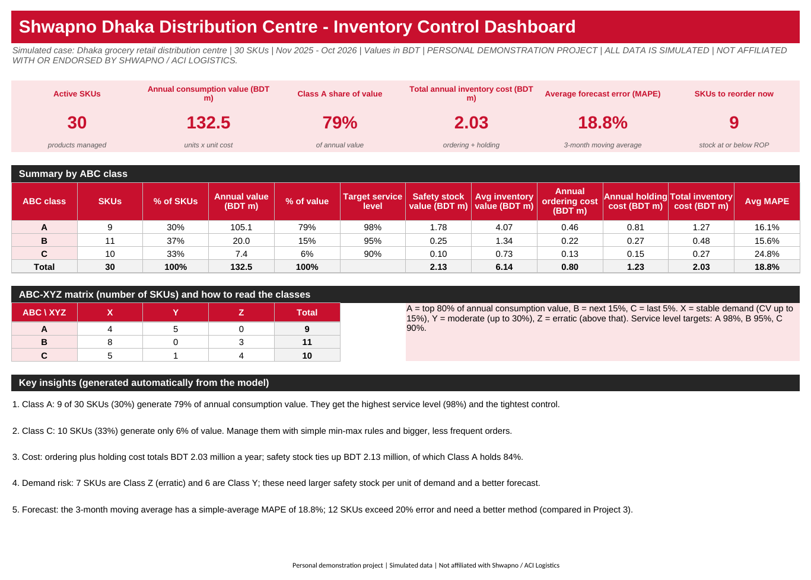
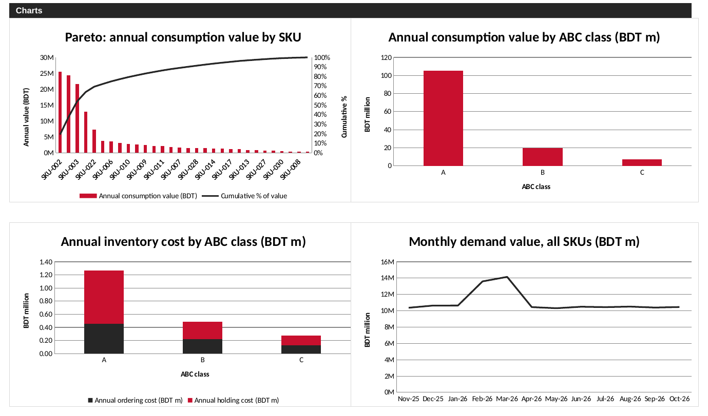

# Inventory Control Model (Simulated Case)

An Excel model for a Dhaka grocery and FMCG distribution centre. It classifies 30 products with **ABC-XYZ analysis**, then calculates **EOQ, safety stock and reorder points**, estimates annual inventory cost, and measures **forecast error**.

> **Disclaimer:** This is a personal demonstration project created for learning and portfolio purposes only. **All data is simulated** (products, prices, demand, lead times, costs and stock levels). No real or confidential data of any company has been used. The workbook uses the name "Shwapno" and a red, white and black colour style only to give the case a realistic setting. It was not prepared for, and is not affiliated with or endorsed by, Shwapno, ACI Logistics Limited or any other company. No logo is used, and the results do not describe any company's real operations.

## Business problem

A central distribution centre must avoid two costly outcomes:

- **Stock-outs:** lost sales and lost customer trust.
- **Overstock:** cash tied up in stock, warehouse space, and expiry or damage.

The model answers four questions: which products need the most attention, how much to order, when to order, and how much safety stock to hold.

## What the model does

1. Ranks the 30 SKUs by annual consumption value (**ABC**) and by demand variability (**XYZ**).
2. Sets a target service level for each class: A 98%, B 95%, C 90%.
3. Calculates **EOQ**, **safety stock** and **reorder point** for every SKU.
4. Checks current stock against the reorder point and flags SKUs to reorder now.
5. Estimates annual ordering, holding and total inventory cost.
6. Measures forecast accuracy (MAD, MAPE, bias) using a 3-month moving average.

## Key results

| Result | Value |
|---|---|
| SKUs analysed | 30 (12 months of demand, Nov 2025 to Oct 2026) |
| Annual consumption value | BDT 132.5 million |
| Class A | 9 SKUs (30%) generate 79% of value |
| ABC-XYZ matrix | The 5 SKUs in cell AY (oil, sugar, flour, lentil) carry 53% of value |
| Total annual inventory cost | BDT 2.03 million (ordering 0.80 + holding 1.23) |
| Safety stock investment | BDT 2.13 million, 84% of it in Class A |
| SKUs to reorder now | 9 |
| Average forecast error (MAPE) | 18.8%; 12 SKUs above 20% |

**Worked example, Soybean Oil 1L (Class A, 98% service level):** EOQ 4,905 units, safety stock 2,888 units, reorder point 6,337 units. Stock on hand is 5,070, below the reorder point, so the model flags it to reorder now.

## Method

| Metric | Formula |
|---|---|
| Annual consumption value | Annual demand × unit cost |
| ABC class | A if cumulative value share is up to 80%, B up to 95%, otherwise C |
| Coefficient of variation (CV) | Standard deviation of monthly demand ÷ average monthly demand |
| XYZ class | X if CV is up to 15%, Y up to 30%, otherwise Z |
| Z-score | `NORMSINV(service level)` |
| EOQ | √(2 × D × S ÷ H), where H = unit cost × 20% |
| Safety stock | Z × daily demand standard deviation × √(lead time) |
| Reorder point | Average daily demand × lead time + safety stock |
| Total annual inventory cost | (D ÷ Q) × S + (Q ÷ 2 + safety stock) × H |
| MAPE | Average of \|actual − forecast\| ÷ actual |

D = annual demand, S = ordering cost per order, H = holding cost per unit per year, Q = order quantity.

## Files in this repository

| File | Description |
|---|---|
| `Project1_Inventory_Control_Model.xlsx` | The full Excel model (10 sheets, about 2,500 live formulas) |
| `Project1_One_Page_Summary.pdf` | One-page summary of the project |
| `dashboard.png`, `charts.png` | Screenshots of the Dashboard sheet |

## How to use

1. Download `Project1_Inventory_Control_Model.xlsx` (GitHub cannot preview Excel formulas).
2. Open the **README** sheet first, then the **Dashboard** sheet.
3. Read the **Analysis** sheet for the SKU-level numbers, and **Formula_Guide** for every formula in plain English.
4. To test scenarios, change any blue input cell on **Assumptions**, **SKU_Master** or **Demand_Data**. Every sheet recalculates automatically.

## Data

All data is simulated: 30 generic products in four categories (edible oil and staples, beverages and snacks, personal care, home care), with seasonal demand patterns for Ramadan and Eid, winter, summer and monsoon. Prices, lead times (5 to 12 days) and ordering costs are illustrative assumptions.

## Limitations

- Simulated data, so real-world messiness (missing months, stock-out periods, one-off bulk orders) is not included.
- Demand is assumed to be roughly normal and independent from day to day.
- Lead time is assumed to be constant.
- Seasonality increases the standard deviation, so safety stock is conservative for seasonal items.
- Single warehouse. No quantity discounts, minimum order quantities or stock-out cost.
- Holding cost is fixed at 20% of unit cost for all products.

## Skills demonstrated

Inventory management · ABC-XYZ analysis · EOQ · safety stock and reorder point · forecast error (MAD, MAPE, bias) · Excel (SUMIF, COUNTIFS, INDEX/MATCH, LARGE, NORMSINV, STDEV) · dashboard design · documentation

## Author

**Alamin Hossain Asif** · Dhaka, Bangladesh · Supply chain portfolio, Project 1

LinkedIn: [add your LinkedIn profile link here]
